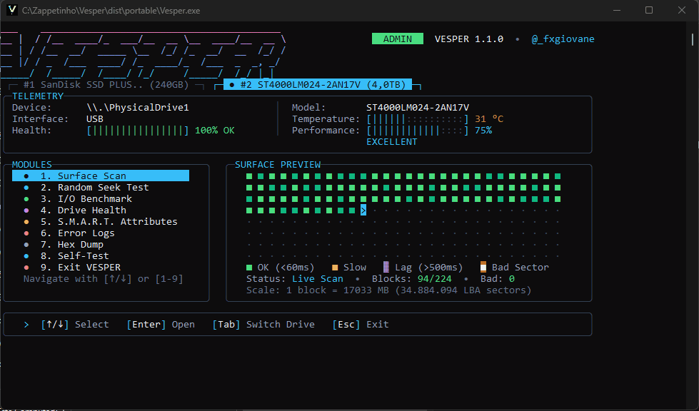
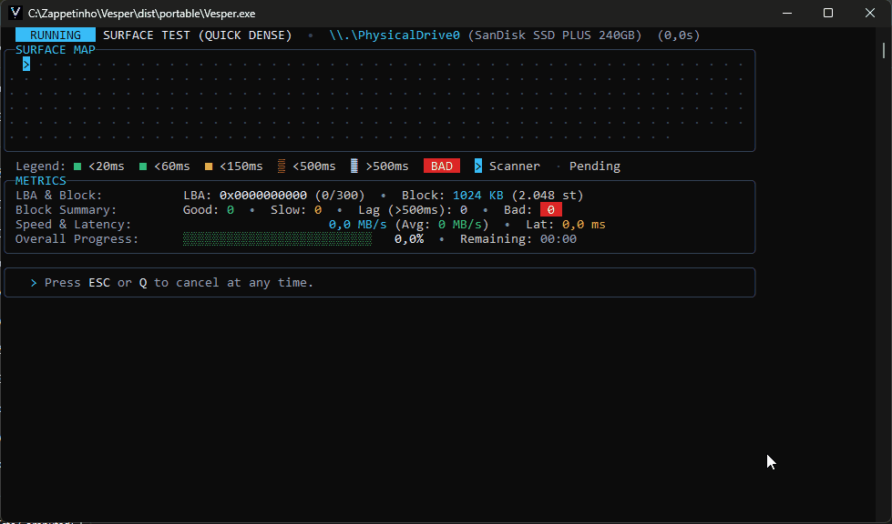
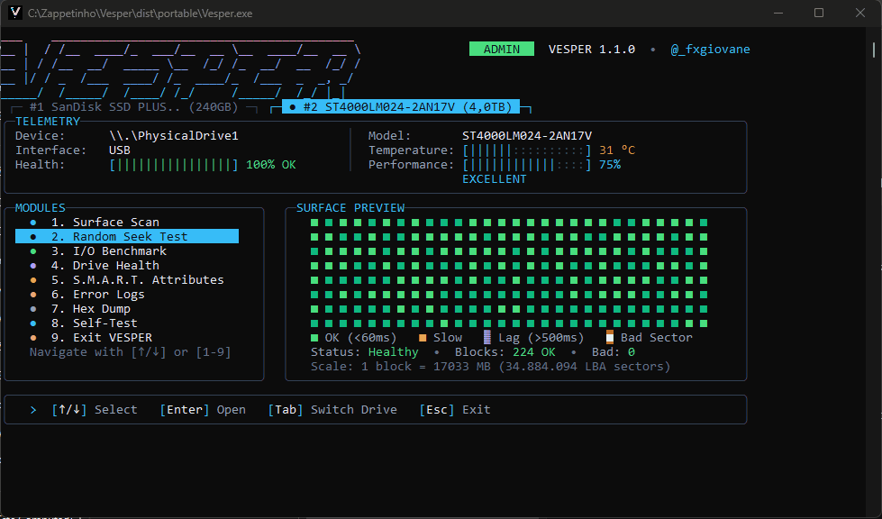
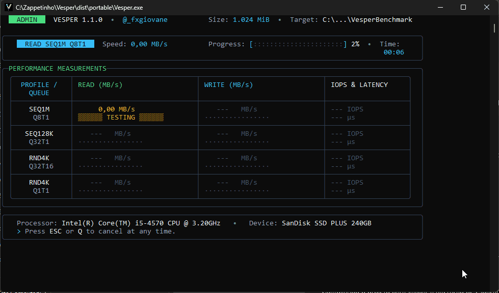
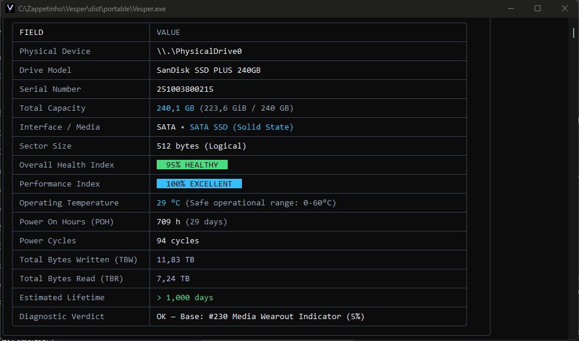

<div align="center">

# VESPER

**Terminal storage telemetry, physical drive diagnostic, and unbuffered benchmark for Windows.**

[](LICENSE)
[](https://dotnet.microsoft.com/)
[](https://microsoft.com)
[](#download)

<br/>



</div>

---

## Overview

Vesper is a standalone terminal utility for Windows built on .NET 10. It interacts directly with kernel storage miniports, physical drive handles, and host controller drivers via Win32 IOCTL calls. 

It provides real-time drive health assessment, SMART telemetry decoding, unbuffered storage benchmarking, sector surface scanning, and high-frequency seek stress testing in a lightweight console interface.

## Highlights

* **Hardware Telemetry**: Direct parsing of NVMe Log Page 0x02, ATA/SATA SMART structures, SCSI pass-through, and hardware RAID controllers including AMD RAIDXpert2, Intel VROC, Marvell, and HPE Smart Array.
* **Kernel-Level Benchmarking**: Windows I/O Completion Ports (IOCP) with non-buffered flags, sector-aligned memory buffers, multi-threaded worker pools, randomized data patterns, and SLC cache cool-down pauses.
* **Surface Scan**: Physical sector reading with latency profiling, block degradation mapping, and defect isolation.
* **Random Seek Stress Test**: QueryPerformanceCounter timing for individual I/O operations, reporting real-time latency percentiles and sustained IOPS.
* **Automation Ready**: Structured JSON output format for headless server inspection, PowerShell automation, and remote telemetry pipelines.
* **Single Executable**: Self-contained native binary. No runtimes or external dependencies to install.

---

## Live Demonstrations

| Surface Scan & Sector Latency | Random Seek Stress Test |
| :---: | :---: |
|  |  |

| IOCP Unbuffered Benchmark | Drive Health & Forensic Telemetry |
| :---: | :---: |
|  |  |

---

## Installation

Download the latest `Vesper.exe` from the Releases page. 

Run from an elevated command prompt or PowerShell session:

```powershell
.\Vesper.exe
```

> **Note**: Direct kernel handle access (`\\.\PhysicalDriveX`) requires Administrator privileges on Windows. If run from a standard terminal, Vesper requests elevation via UAC.

---

## Command Line Usage

### Interactive Terminal Mode

Running without arguments launches the interactive console dashboard:

```powershell
.\Vesper.exe
```

### CLI Mode & Automation

Vesper supports direct command line switches for automation, scripted testing, and headless reporting:

```powershell
# Quick summary of all detected physical drives
.\Vesper.exe --scan

# Full SMART report and health analysis for Drive 0
.\Vesper.exe 0

# Full SMART report with raw 512-byte hex dump
.\Vesper.exe 0 --raw

# Export telemetry for all drives as structured JSON
.\Vesper.exe --json

# Run 4-stage unbuffered benchmark on Drive 0
.\Vesper.exe --benchmark 0

# Run dense surface scan on Drive 0 (Quick sampling)
.\Vesper.exe --surface 0
.\Vesper.exe --surface-quick 0

# Run exhaustive 100% linear surface scan across all LBAs
.\Vesper.exe --surface 0 --full
.\Vesper.exe --surface-full 0 -y

# Run Butterfly seek stress test (calibrated QPC latency & IOPS)
.\Vesper.exe --seek 0

# Trigger drive firmware self-test (short / extended / abort)
.\Vesper.exe --selftest short 0

# View firmware self-test execution log history (Log 0x06)
.\Vesper.exe --selftest-log 0

# Automated hardware verification harness across all drives
.\Vesper.exe --verify-all
.\Vesper.exe --verify-all-full -y
```

---

## Options Reference

| Option | Shorthand | Description |
| :--- | :--- | :--- |
| `[index]` | | Target physical drive index (e.g. `0` for `\\.\PhysicalDrive0`). |
| `--tui` | | Force launch interactive terminal dashboard. |
| `--benchmark` | | Run IOCP unbuffered sequential and random read/write benchmark. |
| `--surface` | | Run sector surface read latency scan. |
| `--surface-quick <idx>` | | Direct quick surface scan (300 sample zones). |
| `--surface-full <idx>` | | Direct exhaustive 100% linear surface scan. |
| `--full` | | Used with `--surface` to force 100% linear scan across all blocks. |
| `--seek` | | Run high-frequency random seek test with QPC timing. |
| `--selftest <m>`| | Send firmware diagnostic command (`short`, `extended`, `abort`). |
| `--selftest-log <idx>` | | Query firmware microcode self-test log history (Log 0x06). |
| `--verify-all` | | Automated deep hardware verification across all detected drives. |
| `--verify-all-full` | | Automated full 100% linear LBA verification across all drives. |
| `-y` | | Non-interactive auto-confirm (skips 100% LBA prompt). |
| `--scan` | `-s` | Output single-line summary per drive (model, serial, bus, capacity). |
| `--json` | `-j` | Output telemetry and attributes in structured JSON. |
| `--raw` | `-r` | Include raw 512-byte hex dump of IDENTIFY / NVMe data. |
| `--strict` | | Apply stringent degradation thresholds for enterprise workloads. |
| `--verbose` | `-v` | Show driver query logs and SCSI miniport response traces. |
| `--help` | `-h`, `/?` | Display command line options and syntax. |

---

## Storage Architecture & Methodology

### 1. Direct Kernel I/O
Vesper opens drive handles using `FILE_FLAG_NO_BUFFERING` and `FILE_FLAG_WRITE_THROUGH`. This bypasses the Windows File System Cache entirely, ensuring reads and writes hit physical flash cells or platters rather than system RAM.

### 2. IOCP Parallelism
Multi-threaded test profiles execute against Windows I/O Completion Ports (`CreateIoCompletionPort` and `GetQueuedCompletionStatusEx`). Asynchronous requests are queued across multiple worker threads to saturate NVMe host controller queues up to queue depth 32.

### 3. Cache Distortion Countermeasures
Benchmark buffers are filled with cryptographically randomized bytes to prevent hardware-level controller deduplication or compression shortcuts. Each test profile is followed by a 2.5 second cool-down period to let firmware flush temporary SLC caches and stabilize thermal state.

### 4. Telemetry Pipeline
Drive identification and health monitoring follows a cascading probe architecture:
* NVMe Log Page 0x02 via `IOCTL_STORAGE_QUERY_PROPERTY`
* SMART read data via `IOCTL_ATA_PASS_THROUGH`
* Controller-specific miniport routing via `IOCTL_SCSI_MINIPORT` for hardware RAID adapters

---

## Building from Source

### Prerequisites
* Windows 10/11 or Windows Server (x64)
* .NET 10 SDK

### Build Single-File Binary

```powershell
git clone https://github.com/fxgiovane/vesper.git
cd vesper

dotnet publish -c Release -r win-x64 --self-contained
```

The resulting executable will be generated in `bin/Release/net10.0-windows/win-x64/publish/Vesper.exe`.

---

## Specification Standards

Vesper implements open, vendor-neutral hardware communication standards:
* NVM Express Base Specification 1.4 / 2.0 (NVMe Health Information Log Page)
* ANSI INCITS 452-2008 (AT Attachment 8 - ATA/ATAPI Command Set)
* INCITS 408-2005 (SCSI Primary Commands - SPC-4)
* Microsoft Windows SDK Storage IOCTL Reference

---

## Optional Enterprise RAID Integration

Vesper communicates directly with storage controllers via kernel IOCTLs out of the box, requiring zero external dependencies for NVMe, SATA, SAS, USB, and AMD-RAID arrays.

For specialized enterprise storage adapters, Vesper can optionally interface with official manufacturer command-line utilities. If present on the host, Vesper discovers them automatically through:
1. Standard system `PATH`
2. Official vendor installation directories
3. An optional local `tools/` directory placed alongside the executable

| Controller Family | Manufacturer | Utility Name | Required Binary |
| :--- | :--- | :--- | :--- |
| **Smart Array / SmartRAID** | HPE / Microchip | Smart Storage Administrator CLI | `ssacli.exe` |
| **Virtual RAID on CPU (VROC) / RSTe** | Intel Corporation | Intel VROC Command Line Tool | `IntelVROCCli.exe` |
| **RAIDXpert2 Enterprise CLI** | AMD | AMD RAID Configuration Utility | `rcadm.exe` |
| **Marvell RAID Controller** | Marvell Technology | Marvell Storage Utility CLI | `mvsetup.exe` |

*Note: None of the above binaries are bundled with Vesper. Users operating these enterprise controllers can place their officially licensed utilities into the `tools/` subfolder or ensure they are accessible in the system `PATH`.*

---

## License

This project is licensed under the [MIT License](LICENSE).
